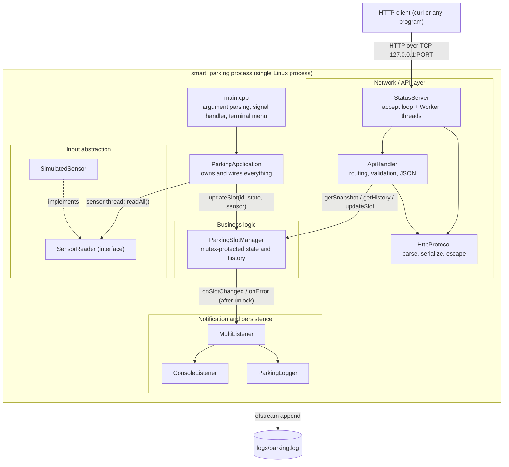
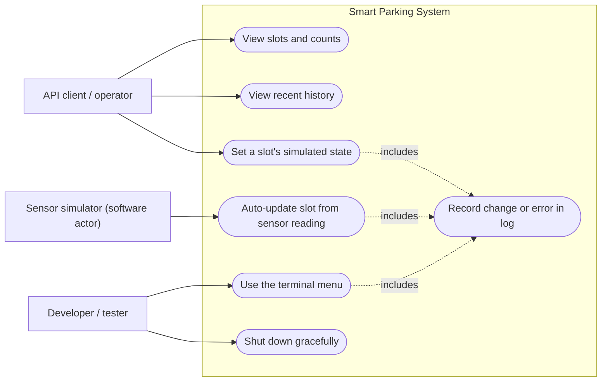
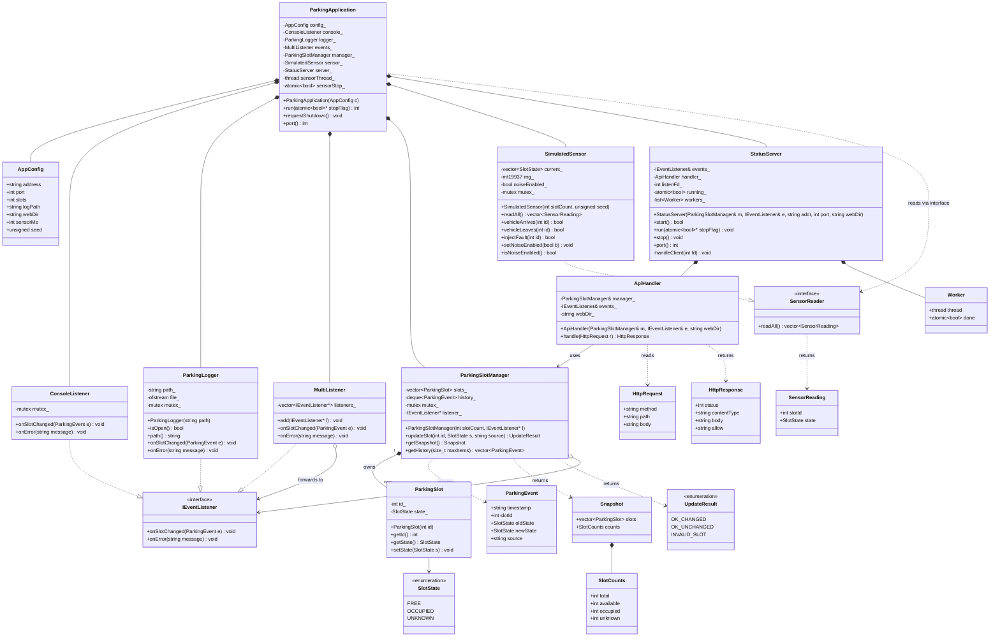
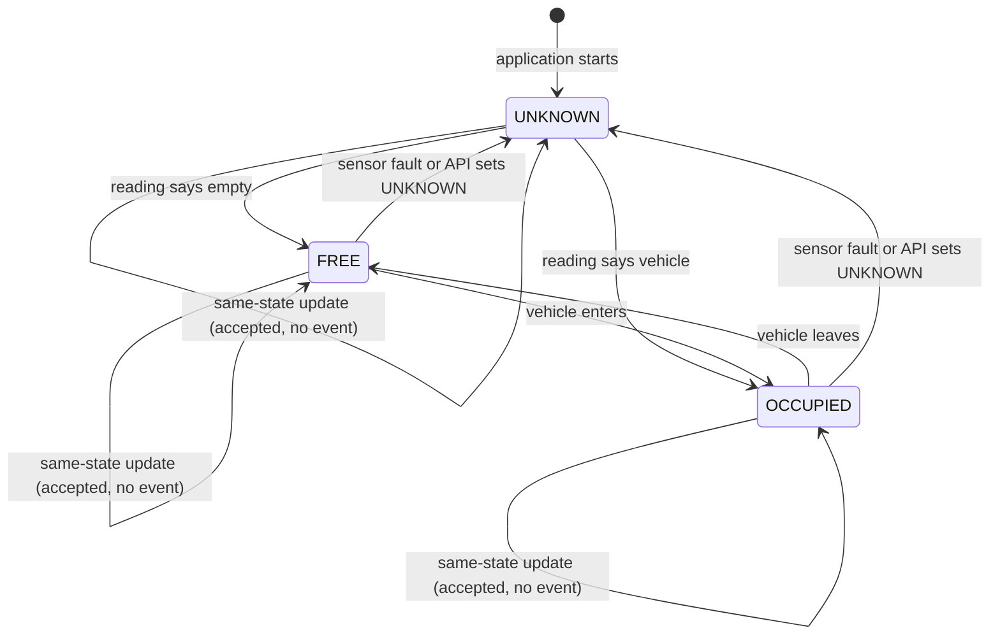
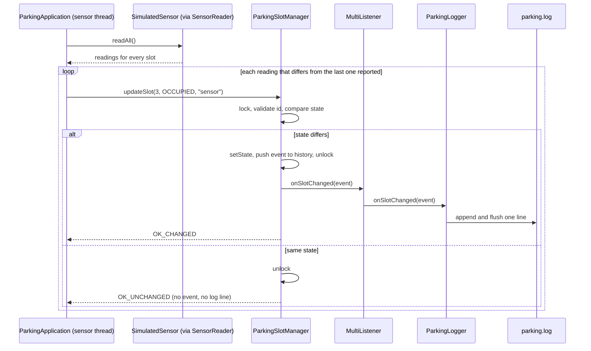
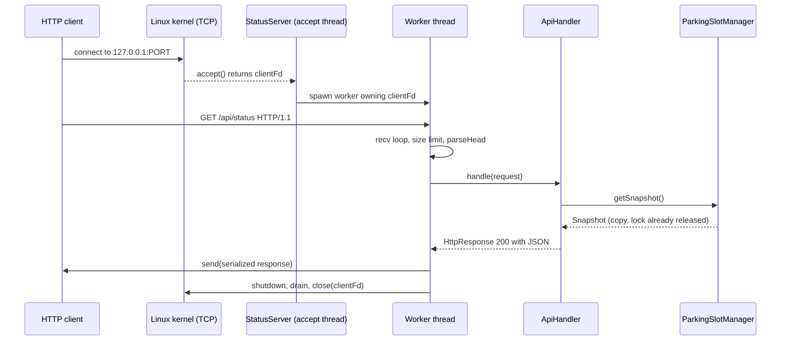
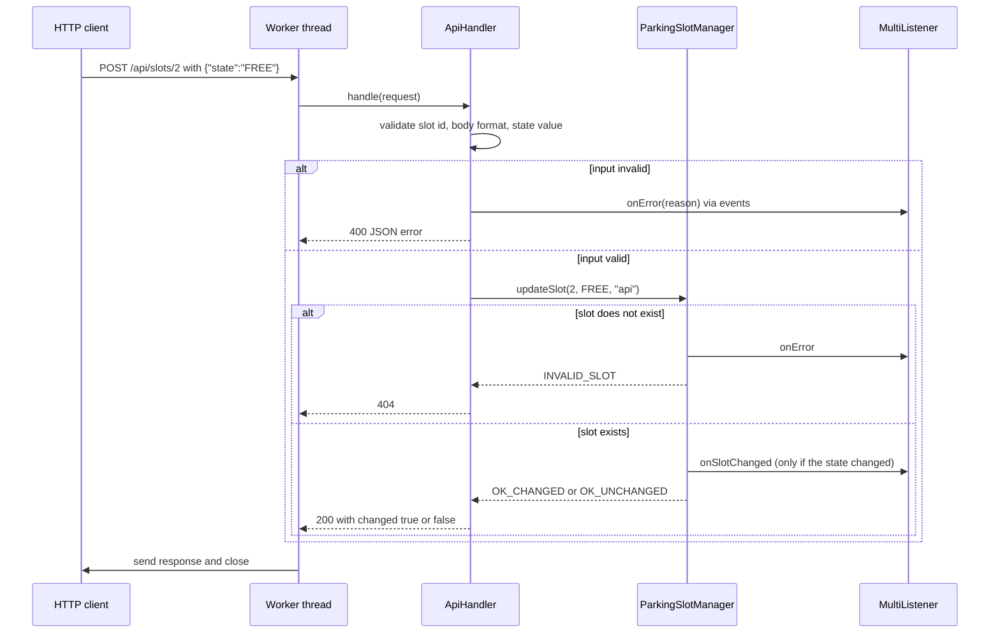

# Smart Parking System: Architecture and UML

Version 2.0 (Phase 12). Matches the implemented code. Supersedes version 1.0.
Differences from the Phase 2 design: HTTP logic split into `HttpProtocol` and
`ApiHandler`; `ParkingApplication` holds members by value; added
`MultiListener`, `ConsoleListener`, `TimeUtil`, `AppConfig`, `Worker`;
the browser dashboard was not built (see REQUIREMENTS.md Amendment 1).

## 1. System architecture

## 2. Use cases

## 3. Class diagram

Free functions not shown as classes: `toString`/`parseState` (SlotState),
`parseHead`, `serialize`, `jsonEscape`, `makeJsonError`, `reasonPhrase`
(HttpProtocol), and `currentTimestamp` (TimeUtil).

## 4. Slot state machine

## 5. Sequence: vehicle enters a slot (sensor thread)

## 6. Sequence: client requests parking status

## 7. Sequence: client changes a slot

